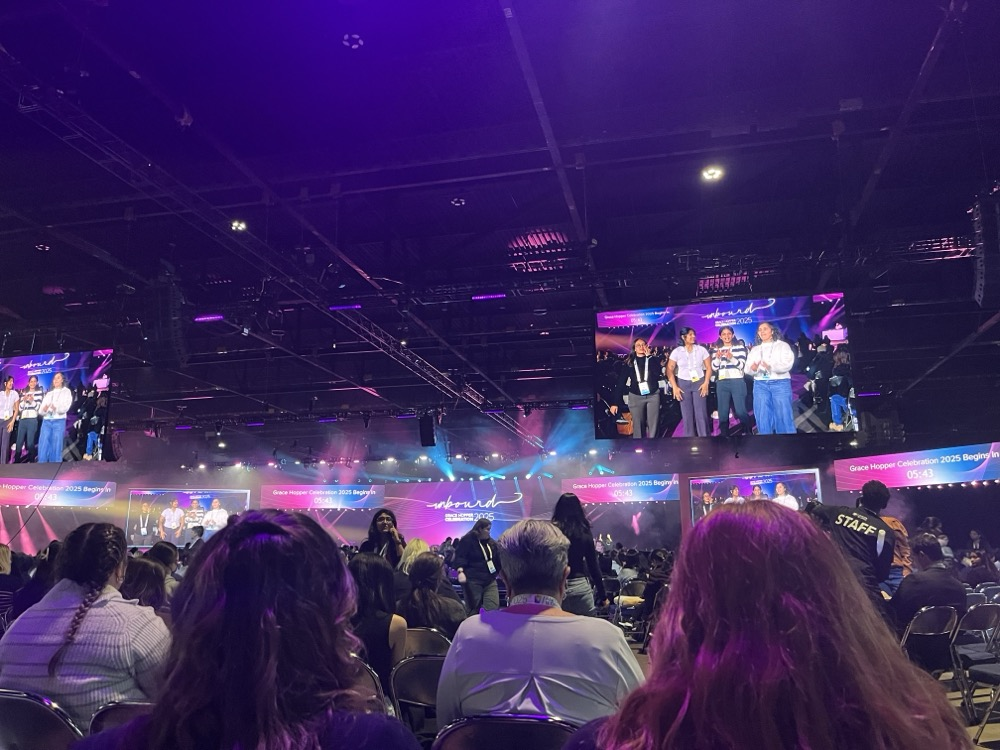
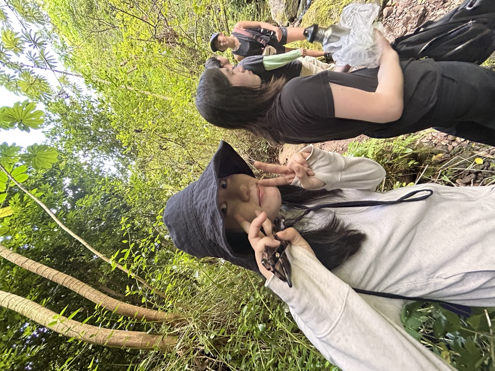
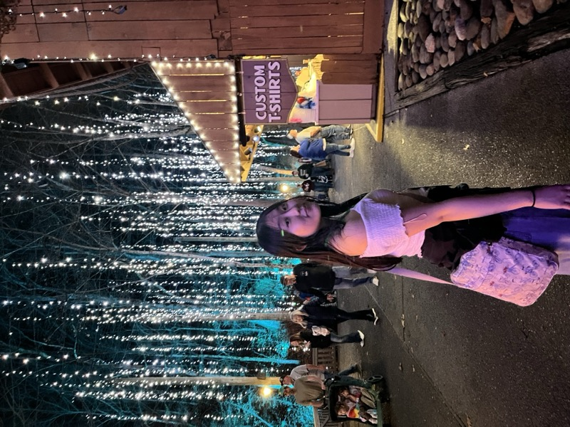

# 🌸 Sara Ota | Aspiring Software Engineer & Innovator 🌸

---

## 🌟 About Me

> **Focused on expanding my toolbox as a software engineer, thinking outside of the box, exploring possibilities, and navigating ambiguity with curiosity and sound judgment.**

**Computer Science & Human & Organizational Development** @ **Vanderbilt University**  
**Aspirations:** Backend/Mobile/Full-stack/Infra Engineering for human-centered design tech  

### 🎯 Involvements
- 🧩 **Google Developer Group:** Event Coordinator
- 👩🏻 **Women in Computing:** VP-Programming Director
- 💡 **Vanderbilt Innovation and Entrepreneurship Society:** Communications Director
- 🔐 **Vanderbilt Blockchain:** Cohort Member

### 📸 Scroll Through My Adventures

<table>
  <tr>
    <td width="50%">
      
      
<b>🇯🇵 Japan Adventure</b> Visiting relatives in Japan during the summer

    </td>
    <td width="50%">
      
      
<b>💻 Grace Hopper Conference</b> Connecting with inspiring women in tech

    </td>
  </tr>
  <tr>
    <td width="50%">
      
      
<b>🌺 Lulumahu Falls, Honolulu</b>

    </td>
    <td width="50%">
      
      
<b>🎢 Dollywood</b> Visiting Dollywood in Gatlinburg, TN

    </td>
  </tr>
</table>

### Beyond Code

| ⛸️ **Figure Skating** | 🏋️‍♀️ **Weightlifting** | 🎤 **Singing** |
|:---:|:---:|:---:|
| 🎶 **Whitney Houston** | 🍳 **Cooking** | ☕ **Escape Rooms** |

---

## 💼 Professional Experience

### 👻 **Software Engineer Intern** | *Snapchat* | *May 2026 – Aug 2026*
**Santa Monica, CA**
- Designed and launched a Snapchat+ Buddy Pass feature across Go, Swift, and TypeScript, dynamically
allocating passes based on friend-network activity for 6M+ subscribers
- Built a high-throughput Go and Cloud Spanner persistence layer managing 10M+ quota states; designed a
lazy-refresh-on-write strategy that reduced database lock contention by 35%
- Launched and monitored a production A/B experiment from 1% to 100% traffic, achieving 35–53%
redemption while resolving Swift and TypeScript client issues through full rollout

### 🚀 **Software Engineer Intern** | *Cloud Warriors* | *Aug 2025 – Dec 2025*
**Nashville, TN**
- Implemented a Playwright E2E automation framework that increased test coverage by 150% (18 to 45 workflows)
across enterprise provisioning and licensing scenarios
- Made a telemetry and automated scoring pipeline using Python, Pandas, and Jinja2, generating diagnostic
reports that eliminated 200+ hours/quarter of manual debugging
- Integrated automated test suites into GitHub Actions CI/CD and resolved session-persistence failures, reducing
test execution errors to 3.75% across 240 runs

### 🌐 **Enterprise Systems Intern** | *American International Group (AIG)* | *June 2025 – Aug 2025*
**Houston, TX**
- Designed interactive UI components in SAP Analytics Cloud using JavaScript
- Integrated REST APIs and optimized data pipelines with SAP HANA and SQL Server, reducing latency by 45%
- Collaborated across 5+ cross-functional teams on scalable data solutions
- Participated in diversity-driven initiatives, supporting inclusion efforts reaching 300+ individuals

### 🎯 **Chief Technology Officer** | *Arrowz* | *Feb 2025 – Jul 2025*
**Nashville, TN**
- Built a Python Retrieval-Augmented Generation (RAG) application using LangChain and LLM APIs, increasing
user engagement by 47% and retention by 31%
- Architected and deployed containerized backend services on AWS EC2, supporting concurrent workloads with
P95 latency under 120ms at peak load
- Led a team of 4 engineers through feature development, code reviews, and CI adoption, increasing sprint velocity
by 40%

---

## 🛠️ Tech Arsenal

### 💻 Languages

### ⚡ Frameworks & Development

### ☁️ Cloud, Infrastructure & Data

### 🤖 AI, Computer Vision & Data

---

## 🚀 Featured Projects

<table>
<tr>
<td width="50%">

### 🧠 The Savage Mindset
**Feminine-focused CBT Web App**
- 💜 Thought reframing based on Margarita Nazarenko's principles
- 🎯 React frontend with TypeScript & Tailwind CSS
- 🤖 OpenAI integration for intelligent responses
- 🌸 Empowering women through healthy thought patterns

</td>
<td width="50%">

### ⛸️ SkateSense
**AI Figure Skating Analysis**
- 🤖 Computer vision with OpenCV & MediaPipe
- 📊 Real-time jump analysis and coaching feedback
- 🎯 Advanced pose estimation for athletes
- 💡 Streamlit interface for video analysis

</td>
</tr>

<tr>
<td width="50%">

### 🏚️ One Short Stay
**Narrative Horror Game • Unity & C#**
- 👁️ Story-driven horror experience set in an unsettling Airbnb
- 🎭 Task, event, and dialogue systems drive an interactive narrative
- 🎮 Built in Unity with custom C# gameplay and interaction systems
- 🇩🇰 Created for the Game Development Core Course at DIS Copenhagen

</td>
<td width="50%">

### 🍽️ Beli for Vandy
**Social Dining Review Platform**
- ⭐ Rate and review Vanderbilt dining halls and individual meals
- 👥 Follow friends and discover what other students recommend
- 🔎 Explore dining halls, reviews, ratings, and meal-time filters
- 💻 Full-stack app with Angular/TypeScript, FastAPI/Python & MongoDB

</td>
</tr>
</table>

---

## 🤝 Let's Connect & Problem Solve Together!

**📧 Email:** [sara.ota@vanderbilt.edu](mailto:sara.ota@vanderbilt.edu)  
**💼 LinkedIn:** [linkedin.com/in/sara-ota](https://linkedin.com/in/sara-ota)  
**🌍 Location:** Currently at Vanderbilt University, Nashville | Originally from Honolulu, Hawaii 🌺

---

